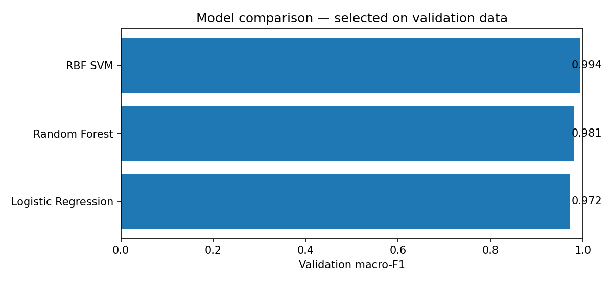

# Handwritten Digit Recognition — End-to-End ML Portfolio

**A small, reproducible machine-learning application: compare three classifiers, investigate errors, and serve predictions through FastAPI and a browser demo.**

`Python` · `scikit-learn` · `Logistic Regression` · `Random Forest` · `SVM` · `Model Evaluation` · `FastAPI` · `Docker` · `pytest`

> **Scope:** Educational portfolio prototype. Uses real, low-resolution digit images included with scikit-learn; does **not** process scanned documents or offer production OCR. The model is trained and tested on one fixed split. Docker instructions are provided, but container execution was not verified in this environment.

## 1. Problem and motivation

**Question:** Can a simple ML pipeline correctly classify handwritten digits (0–9), and **which digits cause the most errors**?

This project goes beyond reporting a single accuracy number. It compares competing models, selects on validation data, evaluates an untouched test set, inspects misclassified images, and exposes the winning model through an API and interactive 8×8 pixel board.

**Data source:** scikit-learn's [`load_digits`](https://scikit-learn.org/stable/modules/generated/sklearn.datasets.load_digits.html), which documents **1,797 handwritten 8×8 grayscale samples** (64 pixel-intensity inputs, values 0–16). It is a copy of the UCI Optical Recognition of Handwritten Digits test set. No external dataset download is needed.

## 2. Results (measured, seed 42)

A fixed **60% training / 20% validation / 20% test**, stratified split gives 1,077 / 360 / 360 images. Models are trained on *training only*, then chosen by **validation macro-F1**. The test set is inspected only after model selection.

| Candidate | Validation accuracy | Validation macro-F1 |
|---|---:|---:|
| Logistic Regression (scaled inputs) | 97.22% | 0.9724 |
| Random Forest | 98.06% | 0.9806 |
| **RBF Support Vector Machine (scaled inputs)** | **99.44%** | **0.9944** |

**Final selected model: RBF SVM.** On the 360-image held-out test set:

| Test metric | Value |
|---|---:|
| Accuracy | **98.06% (353/360 correct)** |
| Macro-F1 | **0.9804** |
| Macro-precision | 0.9812 |
| Macro-recall | 0.9803 |
| Errors | **7 / 360** |

The validation result is stronger than the test result; the difference is a reminder not to present validation performance as unseen-data performance. **No test-driven tuning was performed.** These results reflect one split and are *not* a claim that an SVM will generalise to all handwriting.



## 3. Error analysis — what did the model get wrong?

Rather than stopping at 98% accuracy, the project includes per-class precision/recall, a held-out confusion matrix and images of the **seven misclassified test examples** (ordered by the classifier's reported confidence).


**Examples:** An 8 was classified as 1 (estimated class probability 0.64), and a 4 as 7 (0.58). These figures describe the selected model's output, **not independently calibrated probabilities**. Most mistakes were relatively uncertain, but the more confident mistakes warrant special attention.

Read the full, measured analysis in **[`reports/error_analysis.md`](reports/error_analysis.md)** or inspect **[`reports/results.json`](reports/results.json)** to check the exact numbers and the source indices of mistakes.

## 4. System overview

```text
Built-in real image dataset (scikit-learn load_digits)
             │
             ▼
  Stratified train / validation / test split
             │
             ▼
  Logistic Regression  |  Random Forest  |  RBF SVM
             │
             ▼
  Pick model on validation macro-F1 (no test leakage)
             │
             ├── Held-out test evaluation
             │       ├── Macro-F1, precision, recall
             │       ├── Confusion matrix
             │       └── Error example gallery
             │
             └── Saved model artifact (.joblib)
                        │
                        ▼
                FastAPI /predict
                        │
                        ▼
                 Browser drawing UI
```

## 5. Run locally

**Requirements:** Python 3.11+ and an internet connection for *installing Python dependencies*. The dataset itself is bundled with scikit-learn.

### macOS / Linux

```bash
python3 -m venv .venv
source .venv/bin/activate
python -m pip install -r requirements-dev.txt
python -m pip install --no-deps -e .
python -m digit_classifier.train
pytest -q
uvicorn digit_classifier.api:app --host 127.0.0.1 --port 8000
```

### Windows PowerShell

```powershell
py -3.11 -m venv .venv
.venv\Scripts\Activate.ps1
python -m pip install -r requirements-dev.txt
python -m pip install --no-deps -e .
python -m digit_classifier.train
pytest -q
uvicorn digit_classifier.api:app --host 127.0.0.1 --port 8000
```

Then open **http://127.0.0.1:8000** to draw a digit or load a sample. The **interactive API docs** are at http://127.0.0.1:8000/docs.

> If a PowerShell execution policy blocks activation, use `\.venv\Scripts\python.exe` in place of `python` for each step rather than changing your system policy.

### Docker (container setup, not runtime-verified here)

```bash
docker build -t handwritten-digit-ml .
docker run --rm -p 8000:8000 handwritten-digit-ml
```

The `Dockerfile` installs dependencies, trains the fixed experiment **during the image build**, and serves the trained model. It does *not* require an external volume, remote dataset, token or paid API. Container execution was not tested in the generation environment because the Docker engine was not available.

## 6. Predict through the API

`POST /predict` takes exactly 64 row-major grayscale intensity values (0 to 16), representing one 8×8 digit. The response includes the predicted class, an estimated confidence and ten class probabilities.

```python
import requests
from sklearn.datasets import load_digits

x = load_digits().data[0].tolist()
response = requests.post("http://127.0.0.1:8000/predict", json={"pixels": x}, timeout=10)
response.raise_for_status()
print(response.json())
```

Other endpoints: `GET /health`, `GET /examples` and the homepage `/` (browser UI).

## 7. Repository structure

```text
.
├── README.md
├── Dockerfile
├── pyproject.toml
├── .github/workflows/tests.yml  # CI: train and run tests
├── PORTFOLIO_GUIDE.md           # CV bullets and interview questions
├── requirements.txt
├── requirements-dev.txt
├── src/digit_classifier/
│   ├── modeling.py          # data split and candidate classifiers
│   ├── train.py             # model selection, evaluation, plots and analysis
│   └── api.py               # live inference API
├── tests/
│   ├── test_ml.py           # split invariants, probability shapes and metrics
│   └── test_api.py          # request validation, inference and examples
├── web/index.html           # lightweight 8×8 drawing UI
├── models/model.joblib      # saved fitted example (retrain if versions differ)
└── reports/
    ├── results.json         # structured, real evaluation results
    ├── error_analysis.md    # per-digit breakdown and honest limitations
    └── figures/            # comparison, confusion matrix, errors
```

## 8. Reproducibility and limitations

- **One split:** A single held-out test result is not a confidence interval and does not measure variability across writers or production environments.
- **Image format:** 8×8 pixels are very different from real handwriting captured by phone cameras or scanners. Hand-drawn browser inputs may perform worse.
- **Selection:** Algorithm selection used validation macro-F1. The validation scores are **not** independently confirmed on a separate hyperparameter search split.
- **Probability quality:** Probability outputs are indicative and are **not validated for calibration**; do not interpret confidence as a guaranteed success rate.
- **Security:** The included `.joblib` file is generated locally. Never load untrusted pickle/joblib artifacts. The API has no authentication and is not intended for public deployment.
- **Compute/version notes:** Measured using scikit-learn 1.8.0, Python environment with seed 42. Re-running with different library versions may change probabilities or results.

**Suggested next iteration:** writer-independent evaluation, explicit model probability calibration, perturbation/rotation robustness and a CI pipeline. These are not claimed as implemented.

## 9. Source acknowledgment

Handwritten digits data are loaded from scikit-learn's [`load_digits`](https://scikit-learn.org/stable/modules/generated/sklearn.datasets.load_digits.html), based on the UCI Optical Recognition of Handwritten Digits dataset. See the dataset's original description in scikit-learn for historical source and reference information.

---

*Portfolio repository template — review and understand the training and errors before describing this as personally implemented work in a CV or interview.*
