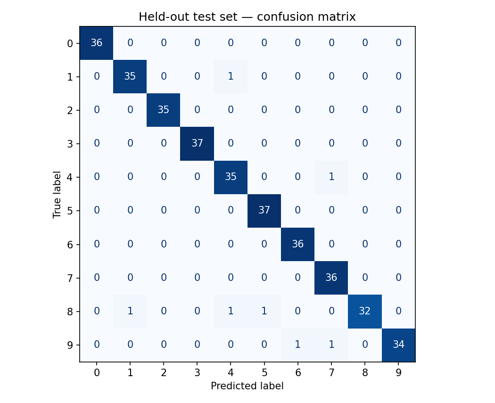
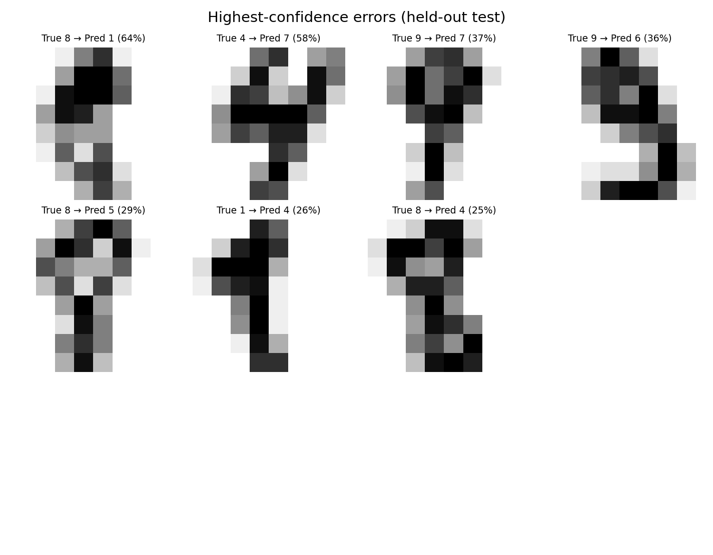

# Error analysis — held-out test set

**Evaluation design:** one stratified 60/20/20 train/validation/test split, seed 42. Model choice uses validation macro-F1; the test set is evaluated only after selection.

**Selected model:** RBF SVM
**Test performance:** accuracy 0.981; macro-F1 0.980; macro-precision 0.981; macro-recall 0.980.
**Errors:** 7 of 360 test images (1.9%).

## What the model gets wrong

The confusion matrix shows which digit pairs are mistaken for one another. The error gallery highlights the most *confident* incorrect predictions, which can be more concerning than uncertain mistakes.

## Per-digit recall

| Actual digit | Recall | Support |
|---:|---:|---:|
| 0 | 100.0% | 36 |
| 1 | 97.2% | 36 |
| 2 | 100.0% | 35 |
| 3 | 100.0% | 37 |
| 4 | 97.2% | 36 |
| 5 | 100.0% | 37 |
| 6 | 100.0% | 36 |
| 7 | 100.0% | 36 |
| 8 | 91.4% | 35 |
| 9 | 94.4% | 36 |

**Lowest recall in this split:** digit 8 (91.4%; n=35).

## Limitations

- The dataset is small (8×8 digit images), unlike modern high-resolution handwritten images.
- A single held-out split does not quantify variance across splits, writers, or deployment conditions.
- Confidence scores are *not* independently calibrated or stress-tested.
- No fairness or robustness claims; no external production deployment.

## Next experimental steps

Evaluate multiple splits or nested CV; test image noise/rotation; collect out-of-distribution examples; assess calibration and confidence-based abstention.
